# Your First Scene: A Sword and an Enemy (Visual Scripting)

A step-by-step guide to building, in Unity with Visual Scripting only:

- a **sword** you can pick up and swing,
- an **enemy** that **wanders** around its home, **chases** you when you get
  close, **attacks**, and has a **health bar** over its head,
- **your health**, shown under your view, and a **respawn** in town when it
  runs out.

It's **solo first**: each player's copy of the world runs its own enemy.
Making it shared ("whoever hits first owns it", design doc 6.3) is the next
step, once this works.

No C#: published worlds don't run C# scripts. Everything here is Unity
components plus Visual Scripting graphs, using only nodes the app allows (the
SDK's allow list includes everything this guide uses).

> Numbers in this guide come from `shared/rules.js` (a level 1 player vs a
> Slime): enemy 30 HP, 4 damage every 1.6 s; you have 80 HP and your sword
> does 8 damage; **one swing counts every 2 s**.

---

## Part 0: What you'll end up with

```
Hierarchy
├── Ground                (a big flat plane, NavMesh baked on it)
├── Spawn Point           (where you arrive and respawn)
├── GameManager           (graph: your health, death, respawn)
├── PlayerHUD             (attached to your head: your health bar)
│   └── HUD Bar Pivot
│       └── HUD Bar Fill
├── Table                 (the sword rests on it)
├── Sword                 (grabbable)
│   ├── Grip              (where your hand holds it)
│   ├── Blade             (trigger collider, tag UserTag1)
│   └── (your sword model)
└── Enemy                 (graph: wander / chase / attack / hit / die)
    ├── (your enemy model, with its Animator)
    └── Health Bar        (turns to face you)
        ├── Bar Background
        └── Bar Pivot
            └── Bar Fill
```

How the pieces talk:

```
 Sword Blade ──touches──► Enemy (On BS Trigger Enter)
                            │  fast enough? 2 s since last hit? → lose 8 HP, update bar
                            │
 Enemy graph ──"PlayerHit" (4)──► GameManager graph
                                     │  lose 4 HP, update HUD
                                     │  at 0: teleport to Spawn Point, refill
                                     └──"PlayerDied"──► Enemy goes home
```

---

## Part 1: Project setup (once)

1. Install **Unity 6000.3.21f1** with **Android Build Support** and
   **Windows Build Support** (in Unity Hub: Installs → the version → Add
   modules).
2. Unity Hub → **New project** → **Universal 3D** template. Name it
   `SBN First Scene`.
3. Import the SDK: download the
   [installer package](https://altvr.app/files/Install-com.sidequest.creator-sdk-latest.unitypackage),
   double-click it with the project open, and click **Import**.
4. Open **Creator SDK → Setup**. Click **Fix All**. This sets up the layers
   and tags the app expects (including `UserLayer9` and `UserTag1`, used below).
5. In the same Setup panel, find **Visual Scripting nodes** and click
   **Generate nodes**. Wait for it to finish (it can take a minute or two).
6. Check the NavMesh package is installed: **Window → Package Manager** →
   top-left dropdown **Unity Registry** → search **AI Navigation**. If it says
   **Install**, click it.
7. Pick and import your sword and enemy models: see **Part 1B** next.

> **Tip:** keep only one scene in this project. The SDK publishes one scene
> per project.

---

## Part 1B: Choose and import your models

You need two things: a **sword** and an **enemy with animations**. There are
two ways to start:

- **No models yet?** Use simple shapes (1B.1) and build the whole scene with
  them. The logic doesn't care what things look like; swap in real models
  later by following 1B.2–1B.6.
- **Ready to pick packs?** Go to 1B.2.

### 1B.1 Placeholder shapes (no packs needed)
- **Sword** (in 3.2, instead of a model): first set the `Grip`'s Scale to
  `0.04, 0.1, 0.04` (a 20 cm hilt). Then right-click `Sword` → **3D Object →
  Cube** → rename `Model`. Position `0, 0.55, 0`, Scale `0.06, 0.9, 0.02` (a
  0.9 m blade above the hilt). **Remove its Box Collider.** In 3.3, give the
  `Blade` collider Center `0, 0.55, 0` and Size `0.08, 0.9, 0.04`.
- **Enemy** (in 4.1, instead of a model): right-click `Enemy` → **3D Object →
  Capsule** → rename `Model`. Position `0, 1, 0`. **Remove its Capsule
  Collider.** Add a small cube as a child at `0, 0.5, 0.5` (a "nose", so you
  can see which way it faces), and remove that cube's collider too.
  **Add Component → Animator** on `Model`, with no Controller. The graph's
  animation nodes then do nothing, which is fine. Skip 4.4.

### 1B.2 What to look for in an enemy pack
Search the Asset Store (**Window → Asset Store**, or assetstore.unity.com)
with words like `low poly fantasy monster animated`, `RPG monster pack`,
`slime animated`, `goblin animated`. Tick **Free Assets** under Pricing to
start cheap.

Check the pack's page before you get it:

| Check | Why | Where on the page |
|---|---|---|
| **Animated**, with at least **idle, walk (or run), attack, hit (or "damage"/"get hit"), death** | The graph uses these five | Description, screenshots, or an "Animations" list |
| **URP** compatible | Our project uses URP; other packs show up pink until converted (1B.5) | "Render pipeline compatibility" table |
| **Low poly**: under ~10,000 triangles per character, textures 2048 or smaller (1024 is better), 1–2 materials | Must run on Quest headsets | Description ("tris", "polys", "texture size"), or "mobile" in the title |
| Works with **Unity 6** | Older packs often still work, but check | "Supported Unity versions" |
| Recent updates and good reviews | Fewer surprises | Reviews tab, "Latest release" |
| Rig type: **Humanoid** is easiest | Humanoid characters can also use animations from other packs or Mixamo | Description; you can also check after import (1B.4) |

**Free alternative for humanoid enemies (goblins, skeletons):**
[Mixamo](https://www.mixamo.com) (free with an Adobe account) has rigged
characters and animations. Download the character as **FBX for Unity** and
each animation **Without Skin**; tick **In Place** for walk/run. Check its
current terms before you use it.

### 1B.3 What to look for in a sword
- A single sword mesh (not one stuck to a character's hand).
- Low poly (under ~2,000 triangles), URP compatible.
- Bonus: a **pivot at the hilt** (the model's centre point is where you'd
  hold it). If not, it still works; you'll just position it by hand in 3.2.
- Weapon packs often have many swords: perfect for later upgrades.

### 1B.4 Import and check (5 minutes, before you build with it)
1. **Window → Package Manager** → top-left dropdown **My Assets** → find the
   pack → **Download** → **Import**. In the import window you can untick demo
   scenes and scripts you don't need (C# scripts don't run in Altspace
   anyway).
2. Drag the model into the scene next to a default **Cube** (which is 1 m).
   - Is it the right **size**? An enemy should look roughly real-world sized
     next to the 1 m cube; a sword should be about 0.8–1.1 m long. If not,
     select the model **file** (FBX) in the Project window → Inspector →
     **Model** tab → change **Scale Factor** → **Apply**.
   - Is it **pink**? See 1B.5.
3. Find the **animations**: in the Project window, click the little arrow on
   the model's FBX file (or on the separate animation FBX files) to expand
   it. The clips have a ▶ triangle icon. Click one, then press ▶ in the
   preview at the bottom of the Inspector to watch it.
4. Write down which clip is which (1B.6).
5. Delete the test model and cube from the scene.

### 1B.5 Fixing common import problems
| Problem | Fix |
|---|---|
| Model is **pink** | The pack was made for the Built-in pipeline. **Back up your project first** (the conversion can't be undone). **Window → Rendering → Render Pipeline Converter** → choose **Built-In Render Pipeline to URP** → tick only **Material Upgrade** (untick **Rendering Settings**: your project is already URP) → **Initialize Converters** → **Convert Assets**. If some stay pink: select the material → **Shader** → **Universal Render Pipeline → Lit**, then put the texture back in **Base Map** |
| Clips **don't play** in the Animator / Animator says "Legacy" | Select the model FBX → Inspector → **Rig** tab → **Animation Type**: **Humanoid** (for two-legged, human-shaped characters) or **Generic** (anything else) → **Apply**. Legacy clips don't work with an Animator Controller |
| Animations in **separate FBX files** play wrong or not at all | Select each animation FBX → **Rig** tab → same Animation Type as the character. For Humanoid: **Avatar Definition: Copy From Other Avatar** → pick the character's avatar → **Apply** |
| **Walk/idle stops** after one cycle | Select the clip (or its FBX → **Animation** tab → the clip) → tick **Loop Time** (and **Loop Pose**) → **Apply**. Only idle and walk loop; attack, hit and death don't |
| Enemy **walks away from its own position** while animating | The walk has root motion. Use an **In Place** version if the pack has one; otherwise keep **Apply Root Motion** unticked on the Animator (4.4 step 6). If the model still drifts or snaps back each loop: select the clip → **Animation** tab → **Root Transform Position (XZ)** → tick **Bake Into Pose** → **Apply** |
| Model is **lying down** or facing backwards | Rotate the `Model` child (not the `Enemy` root) until it stands up and faces **+Z** |

### 1B.6 Record what you picked
Fill this in (copy it into [`docs/assets.md`](assets.md), so the next person
knows):

| Our name | Clip in your pack | Loops? |
|---|---|---|
| Idle | | yes |
| Walk (or Run) | | yes |
| Attack | | no |
| Hit | | no |
| Death | | no |

**Missing one?**
- No **Hit**: leave the Hit state out in 4.4. The `Hit` trigger then does
  nothing.
- No **Walk** but a **Run**: use Run, and raise `WalkSpeed` in the graph
  (6.1) so it doesn't look like running in slow motion.
- No **Death**: leave it out; the enemy simply disappears 2 s after dying.

> **Don't commit Asset Store files to this GitHub repo.** It's public, and the
> Asset Store licence lets you use the assets in your game but not share the
> files. Commit graphs and your own work only; anyone following this guide
> downloads the packs themselves. `docs/assets.md` records which ones.

---

## Part 2: Ground, spawn point and NavMesh

### 2.1 Ground
1. **GameObject → 3D Object → Plane**. Rename it `Ground` (select it, press
   F2).
2. In the **Inspector**, set **Transform → Scale** to `5, 1, 5` (a 50 × 50 m
   floor).
3. Leave its **Layer** on **Default** (players can stand and teleport on it).

### 2.2 Spawn point
1. **GameObject → BS → Player → Spawn Point**.
2. Set its **Position** to `0, 0, -10`. This is where you arrive and where you
   respawn when you die.

### 2.3 Bake the NavMesh (the walkable area for the enemy)
1. Select `Ground`. **Add Component** → search **NavMeshSurface** → add it.
2. On the NavMeshSurface component, click **Bake**.
3. You'll see a blue overlay on the ground in the Scene view. That's where the
   enemy can walk. If you add obstacles later (rocks, walls, the table in
   3.1), click **Bake** again. **Before re-baking once the enemy exists**, set
   the NavMeshSurface's **Include Layers** to leave out **UserLayer9**
   (the enemy's layer, Part 4). Baking skips the object with the Nav Mesh
   Agent, but its model is a child object and could still cut a hole in the
   walkable area around itself.

---

## Part 3: The sword

### 3.1 Start from the grab preset
1. **GameObject → BS → Grab → Cylinder (Stick)**. This makes a ready-to-grab
   object: a **Rigidbody** root (so it has physics and a speed we can measure),
   synced so others see it move, and a child **Stick** whose collider is the
   handle (held anywhere along its length, like a sword grip).
2. Rename the root `Sword`. Rename the child `Stick` to `Grip`.
3. Make a table for it to rest on: **GameObject → 3D Object → Cube**, rename
   `Table`, **Position** `0, 0.45, -8`, **Scale** `1.4, 0.9, 0.6` (waist
   height, just in front of the spawn point).
4. Lay the sword on it: select `Sword`, **Position** `0.4, 0.95, -8`,
   **Rotation** `0, 0, 90`. It drops a few centimetres onto the table when
   you press Play.
5. Leave the Rigidbody's **Is Kinematic** **unticked**. Your hand holds things
   with a physics joint, and a joint can't move a kinematic body: the sword
   would stay stuck, and its speed (which the enemy checks) would read 0.

### 3.2 Add your sword model
1. From your sword pack, drag the sword **prefab or model** onto `Sword` in
   the Hierarchy, so it becomes a child. Rename it `Model`. (No pack yet? Use
   the placeholder in 1B.1.)
2. Set the model's **Position** to `0, 0, 0` and rotate/scale it so **the hilt
   sits on the Grip** (the thin cylinder) and **the blade points up** (along
   the Grip's Y axis, the green arrow).
3. If the model came with its own colliders, **remove them** (select each one,
   click the ⋮ on the collider component → **Remove Component**). We add our
   own.
4. Make the Grip invisible but keep it grabbable: select `Grip`, untick its
   **Mesh Renderer** (leave the **Capsule/Mesh Collider** and **BS Grab
   Handle** alone). Resize the Grip (its Scale Y) so it covers the hilt.

### 3.3 The blade: the part that hits
1. Right-click `Sword` → **Create Empty**. Rename it `Blade`.
2. **Add Component → Box Collider**. Tick **Is Trigger**. Set its **Size** and
   **Center** so the green box covers the blade of your model (look in the
   Scene view).
3. Set `Blade`'s **Layer** to **UserLayer9**. (Teleport and the grapple
   ignore this layer, and grabbing only looks at the Grabbable layer, so the
   blade never gets in the way of picking the sword up by its grip.)
4. Set `Blade`'s **Tag** to **UserTag1**. That's how the enemy knows "this is
   a sword".

> Why a trigger? A trigger doesn't push things around; it only reports "I
> touched something". The sword's Rigidbody (on the root) makes Unity report
> the touch. It also means the blade doesn't rest on anything: the sword lies
> on its grip, which is why it's laid flat on the table.

---

## Part 4: The enemy object

### 4.1 Root and model
1. **GameObject → Create Empty**. Rename it `Enemy`. **Position** `0, 0, 8`.
2. Drag your enemy **model prefab** onto `Enemy` so it's a child. Set the
   child's Position to `0, 0, 0` and make sure it faces **+Z** (the blue
   arrow). Rename the child `Model`. (No pack yet? Use the placeholder in
   1B.1 and skip 4.4.)
3. If the model has its own colliders or a Rigidbody, **remove** them.

### 4.2 NavMeshAgent (walking)
1. Select `Enemy` → **Add Component → Nav Mesh Agent**.
2. Set **Speed** `1.2`, **Angular Speed** `360`, **Stopping Distance** `0.5`.
   Adjust **Radius** and **Height** so the agent's cylinder (Scene view)
   roughly fits the model.

### 4.3 Hitbox
1. Still on `Enemy` → **Add Component → Capsule Collider**.
2. Tick **Is Trigger**. Set **Center**, **Radius** and **Height** to cover the
   model's body.
3. Set `Enemy`'s **Layer** to **UserLayer9** (choose **Yes, change children**
   this time; it's fine for the model too).

### 4.4 Animator (your model's animations)
Uses the clips you found in **1B.4–1B.6**. We drive them with **4
parameters**, so any pack works the same way once its clips are mapped.

1. **Project window** → right-click in your own folder → **Create → Animator
   Controller**. Name it `EnemyController`.
2. Double-click it to open the **Animator** window.
3. In the **Parameters** tab (left), click **+** and add:
   - `Speed` (**Float**)
   - `Attack` (**Trigger**)
   - `Hit` (**Trigger**)
   - `Die` (**Trigger**)
4. Drag the five clips you listed in **1B.6** from the Project window into the
   Animator window: **Idle**, **Walk** (or Run), **Attack**, **Hit**,
   **Death**. Rename each state to those names (select it → name at the top of
   the Inspector), so the table below matches whatever your pack called them.
   - Right-click **Idle** → **Set as Layer Default State** (Unity's manual
     calls it **Set As Default**). The default state is shown in
     orange-brown.
5. Make the transitions (right-click a state → **Make Transition** → click the
   target state). Select each arrow and set it up in the Inspector:

   | From → To | Has Exit Time | Condition |
   |---|---|---|
   | Idle → Walk | off | `Speed` Greater `0.1` |
   | Walk → Idle | off | `Speed` Less `0.1` |
   | **Any State** → Attack | off | `Attack` |
   | Attack → Idle | **on** (Exit Time `1`) | none |
   | **Any State** → Hit | off | `Hit` |
   | Hit → Idle | **on** (Exit Time `1`) | none |
   | **Any State** → Death | off | `Die` |

   For the three **Any State** arrows, untick **Can Transition To Self**.
   Death has no way out: it stays dead until we reset it.
6. Select `Model` (the child) → its **Animator** component (add one if it
   doesn't have it) → set **Controller** to `EnemyController`. **Untick Apply
   Root Motion** (the NavMeshAgent moves the enemy, not the animation).

> If your pack's walk animation slides or looks too fast/slow, change the
> NavMeshAgent **Speed** or the Walk state's **Speed** in the Animator.

### 4.5 Health bar
A bar made of two flat cubes. The green one shrinks from the left as health
drops.

1. Right-click `Enemy` → **Create Empty** → rename `Health Bar`. **Position**
   `0, 2.2, 0` (just above the head; adjust to your model's height).
2. With `Health Bar` selected: **Add Component** → search **BS Billboard** →
   add it. It turns the bar to face you. Untick **Enable X Axis** so it only
   turns sideways.
3. Right-click `Health Bar` → **3D Object → Cube** → rename `Bar Background`.
   Scale `1, 0.12, 0.02`. Remove its **Box Collider**. Make a dark grey
   material for it (Project → Create → Material, set Base Map colour, drag
   onto the cube).
4. Right-click `Health Bar` → **Create Empty** → rename `Bar Pivot`.
   **Position** `-0.5, 0, -0.015` (the left edge, just in front).
5. Right-click `Bar Pivot` → **3D Object → Cube** → rename `Bar Fill`.
   **Position** `0.5, 0, 0`, Scale `1, 0.1, 0.02`. Remove its **Box
   Collider**. Give it a green material.

Scaling `Bar Pivot` on X from 1 down to 0 now shrinks the green bar toward the
left edge. Try it in the Inspector, then set it back to `1, 1, 1`.

> If the bar shows its back to you in the headset, rotate `Bar Background` and
> `Bar Pivot` 180° on Y.

---

## Part 5: Your health (GameManager + HUD)

### 5.1 HUD bar under your view
1. **GameObject → Create Empty** → rename `PlayerHUD`.
2. **Add Component** → **BS Attached Object**. Set:
   - **Uid**: `me` (means "the player looking at it". Left empty, it
     attaches to nobody.)
   - **Avatar Attachment Point**: `HEAD`
   - **Attachment Position**: `0, -0.25, 0.7` (a little below your eyeline)
   - **Auto Attach**: ticked
   - **Auto Sync**: unticked (only you see it)
3. Build the same bar as 4.5 inside it, but smaller: `HUD Bar Background`
   scale `0.3, 0.03, 0.005`; `HUD Bar Pivot` at `-0.15, 0, -0.004`;
   `HUD Bar Fill` at `0.15, 0, 0` (as a child of the pivot), scale
   `0.3, 0.025, 0.005`, red material. **Remove every Box Collider** (colliders
   on your head would bump into things).
   No Billboard here: it's already on your head.

### 5.2 GameManager object and its variables
1. **GameObject → Create Empty** → rename `GameManager`.
2. **Add Component → Script Machine**. Unity also adds a **Variables**
   component.
3. On **Script Machine**, set **Source** to **Graph** → click **New** → save
   it as `GameManagerGraph`.
4. In the **Variables** component, click **+** for each (name, type, value):

   | Name | Type | Value |
   |---|---|---|
   | `MaxHealth` | Float | `80` |
   | `Health` | Float | `80` |
   | `HudPivot` | Transform | drag `HUD Bar Pivot` in |
   | `SpawnPoint` | Transform | drag `Spawn Point` in |

### 5.3 Visual Scripting basics (read once)
- Click **Edit Graph** on the Script Machine to open the graph window.
- **Add a node:** right-click empty space → the **fuzzy finder** opens → type
  the name in **bold** below → click it.
- **Wires:** drag from an output port (right side) to an input port (left
  side). **Green arrows** are the order things happen in ("flow"); other
  colours carry values (numbers, positions, objects).
- **Variables:** in the fuzzy finder, open **Variables → Object** and pick
  **Get Object Variable** or **Set Object Variable**. Type the variable's
  name in the node's name box (or pick it from the dropdown). Object variable
  nodes also have a GameObject box: leave it on **This**. (Shortcut: drag a
  variable from the **Blackboard** panel's **Object** tab onto the graph to
  make a Get node; hold **Alt** while dropping to make a Set node.) Variable
  nodes are teal.
- **Numbers on ports:** click an unconnected input port's box to type a value.
- **Words and numbers with no box:** some ports (like **Set Variable**'s
  Value, or **Equal**'s A and B) have no box to type into. Add a small
  literal node instead: in the fuzzy finder type **String** (for words like
  `Chase`) or **Float** (for numbers) and pick the result marked
  **Literal**. Type the value in it and wire it in.
- **Comparing words:** if an **Equal** or **Not Equal** node shows number
  boxes on A and B, select it and untick **Numeric** in the Graph Inspector.
- **Expose** (splits a position into X, Y, Z): if you can't find it, use
  **Vector 3: Get X**, **Get Y** and **Get Z** nodes instead. They do the
  same job.
- **Save** with Ctrl+S.

**Pictures:** every graph below has a picture drawn in the style of Unity's
graph window. Build what you see, left to right. (They're drawn from this
guide, not screenshots, so small details like icons look a little different.)
Long graphs are split into several pictures; a yellow note says where each
one carries on. Click a picture to see it full size.

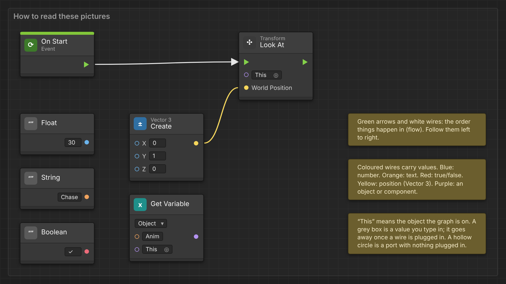


### 5.4 GameManagerGraph
Delete the default **On Start** / **On Update** nodes if you don't need them.

**A. Update the HUD bar (a reusable "Custom Event")**
1. **Custom Event** → name it `UpdateHud`.
2. **Divide** (Scalar) → A: Get Variable `Health`, B: Get Variable `MaxHealth`.
3. **Clamp 01** (Mathf) → input from Divide. (Keeps it between 0 and 1.)
4. **Vector 3: Create (X, Y, Z)** → X from Clamp 01, Y `1`, Z `1`.
5. **Transform: Set Local Scale** → its target (top input) from Get Variable
   `HudPivot`; value from the Vector 3. Flow: Custom Event → Set Local Scale.


**B. On start: fill up**
1. **On Start** → **Set Variable** `Health` (value: Get Variable `MaxHealth`)
   → **Trigger Custom Event** (under **Events**, right below Custom Event;
   name `UpdateHud`, target: **This**). The name must match exactly,
   including capitals.

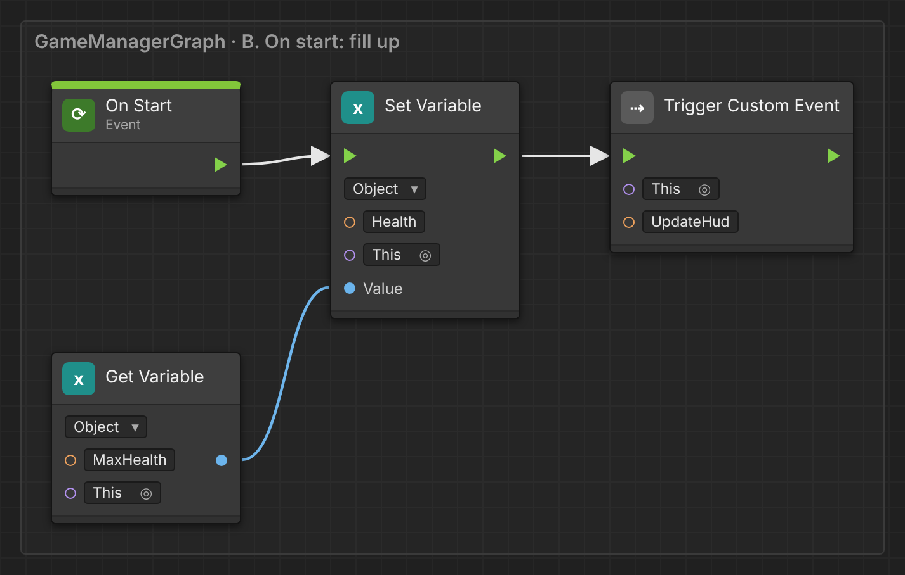

**C. Getting hit**
1. **On Global Event** (Events → BS → Utils). Click it; in the Graph
   Inspector set **Arguments** to `1`. Type `PlayerHit` in its name box.
2. **Subtract** (Scalar) → A: Get Variable `Health`, B: the event's
   `argument_0`.
3. **Set Variable** `Health` ← Subtract. Flow: On Global Event → Set Variable.
4. → **Trigger Custom Event** `UpdateHud` (target **This**).
5. → **If**: condition **Less Or Equal** (A: Get Variable `Health`, B: `0`).
6. If **True** →
   1. **Teleport To Location** (BS → User): **Position** ← **Transform: Get
      Position** of Get Variable `SpawnPoint`. Tick **Stop Velocity**.
   2. → **Set Variable** `Health` ← Get Variable `MaxHealth`.
   3. → **Trigger Custom Event** `UpdateHud`.
   4. → **Trigger Global Event** (BS → Utils), name `PlayerDied`, Arguments
      `0`.

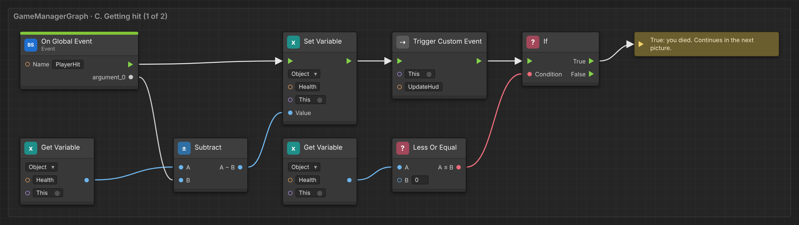

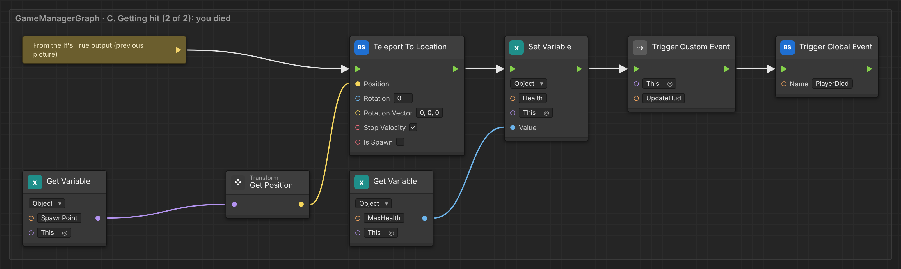

That's your health done. Later, `PlayerDied` is also where the backend's
"death" event (lose 10% gold) will be sent.

---

## Part 6: The enemy's brain (EnemyGraph)

### 6.1 Script Machine and variables
1. Select `Enemy` → **Add Component → Script Machine** → Source **Graph** →
   **New** → save as `EnemyGraph`.
2. In its **Variables** component add:

   | Name | Type | Value | What it's for |
   |---|---|---|---|
   | `State` | String | `Wander` | Wander, Chase, Attack, Return or Dead |
   | `MaxHealth` | Float | `30` | |
   | `Health` | Float | `30` | |
   | `Home` | Vector 3 | (set at start) | Where it lives |
   | `WanderRadius` | Float | `5` | How far it strolls from home |
   | `AggroRange` | Float | `6` | Get this close and it chases you |
   | `AttackRange` | Float | `1.8` | Close enough to hit you |
   | `LeashRange` | Float | `15` | Chased this far from home → gives up |
   | `WalkSpeed` | Float | `1.2` | |
   | `RunSpeed` | Float | `3` | |
   | `Damage` | Float | `4` | Per attack |
   | `AttackEvery` | Float | `1.6` | Seconds between attacks |
   | `SwordDamage` | Float | `8` | Per hit you land |
   | `MinSwingSpeed` | Float | `1.5` | m/s: slower is a touch, not a hit |
   | `SwingCooldown` | Float | `2` | Only one hit counts every 2 s |
   | `RespawnSeconds` | Float | `15` | |
   | `NextWanderTime` | Float | `0` | (used by the graph) |
   | `LastAttackTime` | Float | `0` | (used by the graph) |
   | `LastHitTime` | Float | `-10` | (used by the graph) |
   | `PlayerFlat` | Vector 3 | `0, 0, 0` | (used by the graph) Your position, at the enemy's height |
   | `PlayerDistance` | Float | `0` | (used by the graph) How far you are |
   | `Anim` | Animator | drag `Model` in | |
   | `BarPivot` | Transform | drag `Bar Pivot` in | |
   | `Model` | Game Object | drag `Model` in | |
   | `HealthBar` | Game Object | drag `Health Bar` in | |

> Nav Mesh Agent and Capsule Collider nodes work on **this** object by
> default (the Enemy), so they don't need variables.

The graph has six parts. Build them one at a time and test as you go
(Part 7). Use **Groups** (Ctrl+drag a box around nodes → name it) to keep
them tidy.

### 6.2 Part A: start and the health bar
1. **Custom Event** `UpdateBar` → same as the HUD (5.4 A) but with
   `Health`/`MaxHealth`/`BarPivot`.
2. **On Start** →
   **Set Variable** `Home` ← **Transform: Get Position** (target **This**) →
   **Set Variable** `Health` ← Get Variable `MaxHealth` →
   **Trigger Custom Event** `UpdateBar`.

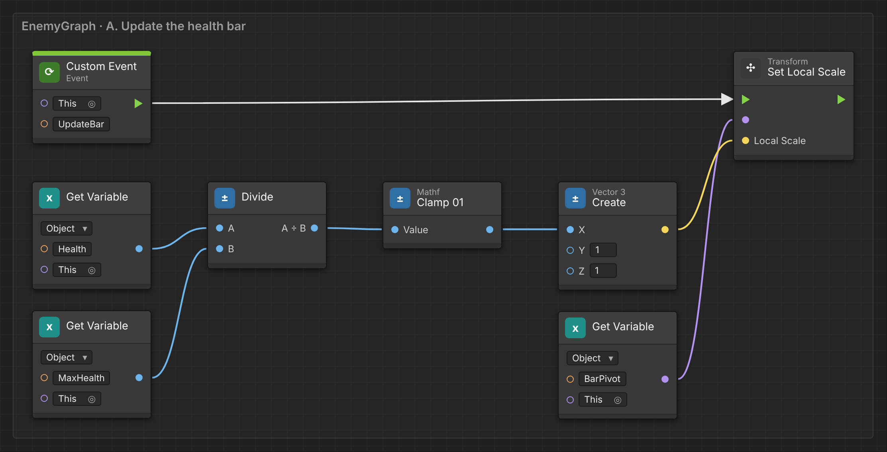

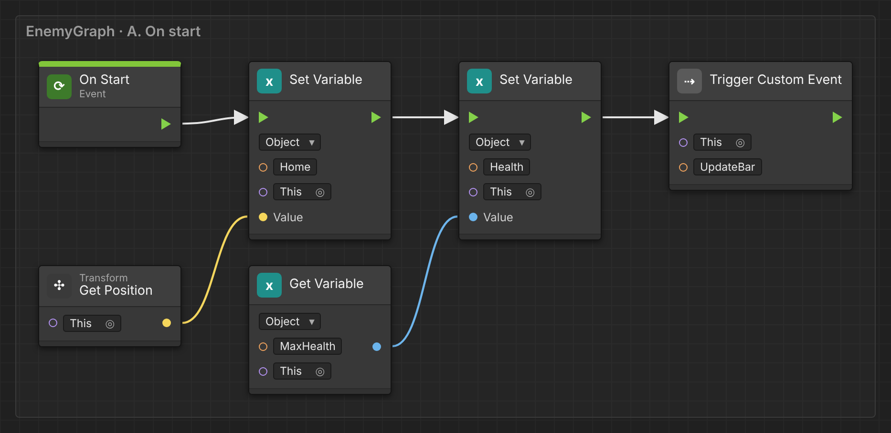

### 6.3 Part B: every frame, look where the player is
Every frame, the enemy works out where you are and saves it in two
variables, so the four states (6.4) can just read them.

1. **On Update** → **Set Variable** `PlayerFlat`. Its value is your position
   at the enemy's height:
   - **Local User State** (BS → User) gives your head **Position** → into an
     **Expose** node (Vector 3), which splits it into X, Y, Z.
   - **Transform: Get Position** (target **This**) → another **Expose**.
   - **Vector 3: Create** with X = your X, **Y = the enemy's Y**, Z = your Z.
2. → **Set Variable** `PlayerDistance` ← **Vector 3: Distance** (A: Get
   Variable `PlayerFlat`, B: Transform: Get Position of **This**).

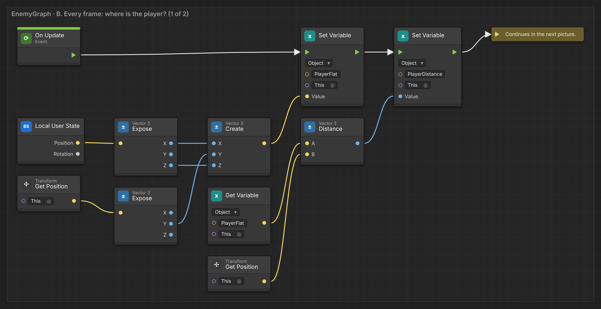

3. → **Animator: Set Float** (target: Get Variable `Anim`), name `Speed`,
   value **Nav Mesh Agent: Get Velocity** → **Vector 3: Get Magnitude**. This
   plays the walk animation when it moves.
4. → **Switch On String**. Its Selector: Get Variable `State`. Select the
   node, and in the Graph Inspector add the options `Wander`, `Chase`,
   `Attack`, `Return`. (`Dead` isn't listed, so a dead enemy does nothing.)

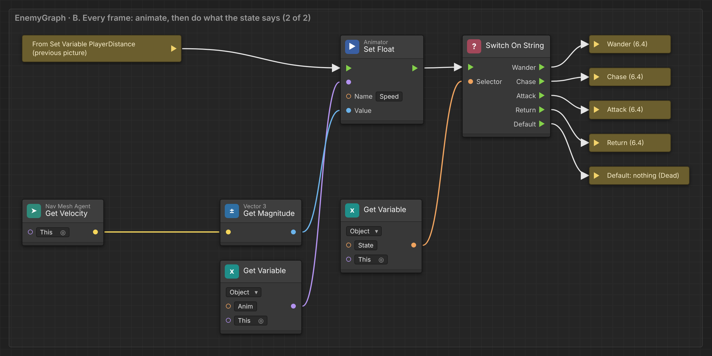

### 6.4 Part C: the four states
Wire each from its output on **Switch On String**.

Wherever a step below says **PlayerFlat** or **Distance to player**, use a
**Get Variable** `PlayerFlat` / `PlayerDistance` node.

**Wander**
1. **If**: Get Variable `PlayerDistance` **Less** `AggroRange` →
   - True: **Set Variable** `State` = `Chase` → **Nav Mesh Agent: Set Speed**
     ← `RunSpeed`.
   - False: **If**: **Time: Get Time** **Greater** `NextWanderTime` →
     True:
     1. **Random: Inside Unit Circle** → **Expose Vector 2** (x, y).
     2. **Vector 3: Create**: X = x × `WanderRadius`, Y = `0`, Z = y ×
        `WanderRadius` (use **Multiply** nodes).
     3. **Add** (Vector 3) that to Get Variable `Home`.
     4. **Nav Mesh Agent: Set Destination** ← the result.
     5. **Nav Mesh Agent: Set Speed** ← `WalkSpeed`.
     6. **Set Variable** `NextWanderTime` = Get Time + **Random: Range**
        (`3`, `6`).

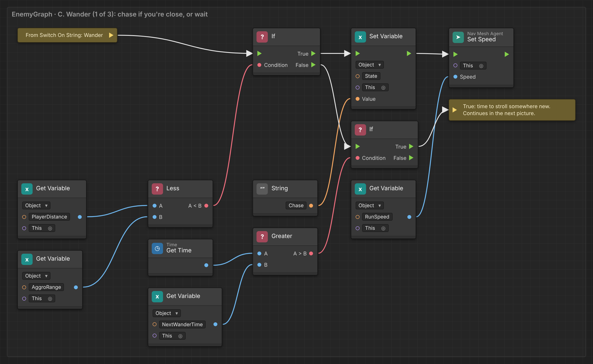

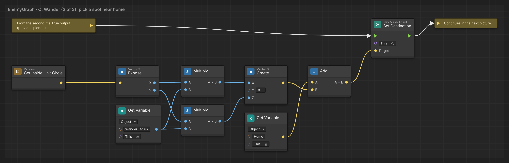

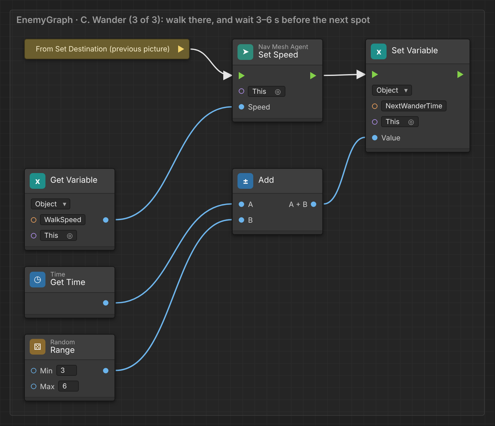

**Chase**
1. **Nav Mesh Agent: Set Destination** ← PlayerFlat → **Nav Mesh Agent: Set
   Speed** ← `RunSpeed`. (Setting the speed here too means it runs however
   the chase started, including when you hit it from behind.)
2. → **If**: **Vector 3: Distance** (Transform position, Get Variable
   `Home`) **Greater** `LeashRange` → True: **Set Variable** `State` =
   `Return`. **Nav Mesh Agent: Set Destination** ← `Home`.
3. False → **If**: Distance to player **Less** `AttackRange` → True:
   **Set Variable** `State` = `Attack` → **Nav Mesh Agent: Reset Path**.

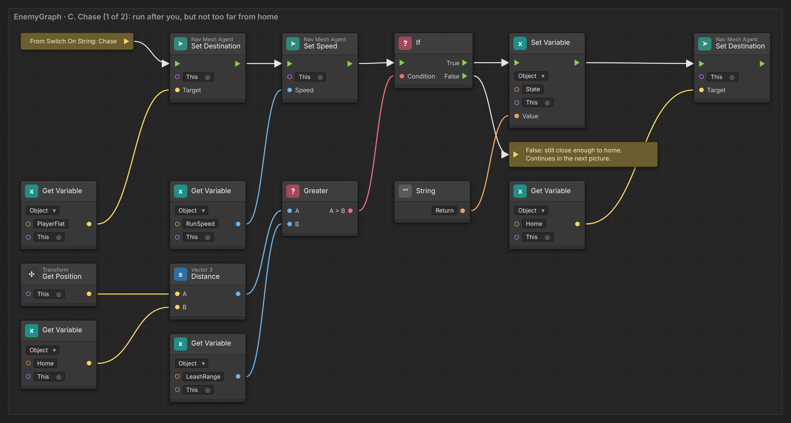

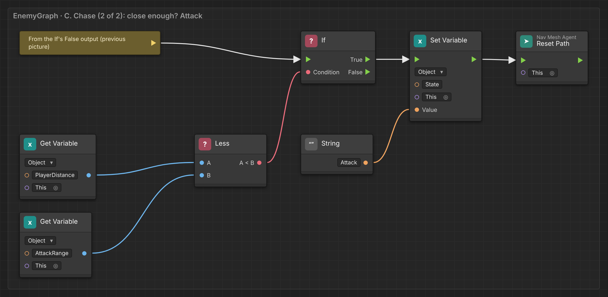

**Attack**
1. **Transform: Look At** (target **This**) ← PlayerFlat. (Turns to face you.)
2. → **If**: Distance to player **Greater** `AttackRange` + `0.5` → True:
   **Set Variable** `State` = `Chase`.
3. False → **If**: Get Time **Greater** `LastAttackTime` + `AttackEvery` →
   True:
   1. **Set Variable** `LastAttackTime` = Get Time.
   2. **Animator: Set Trigger** (target `Anim`) name `Attack`.
   3. **Trigger Global Event**, name `PlayerHit`, **Arguments** `1`,
      `argument_0` ← Get Variable `Damage`.

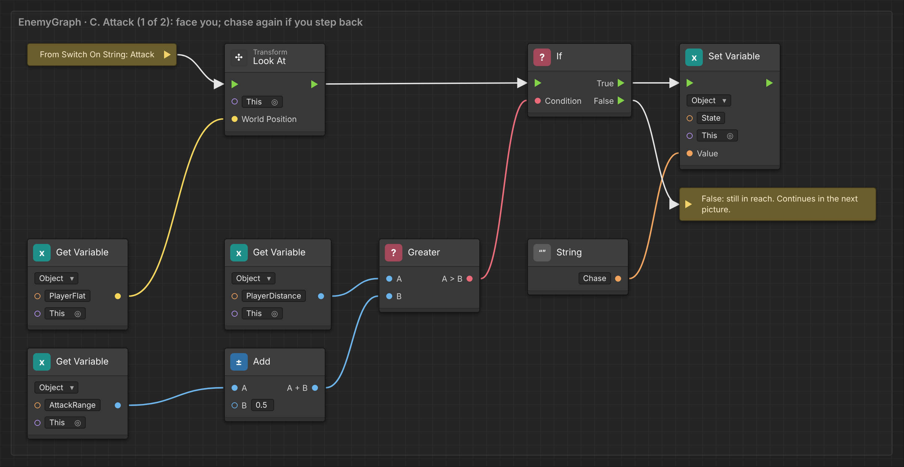

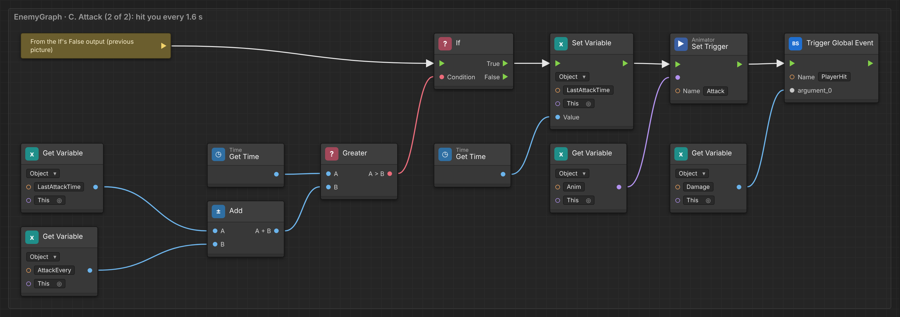

**Return**
1. **If**: **Vector 3: Distance** (Transform position, `Home`) **Less** `1` →
   True:
   1. **Set Variable** `Health` ← `MaxHealth` → **Trigger Custom Event**
      `UpdateBar`.
   2. **Set Variable** `State` = `Wander`.

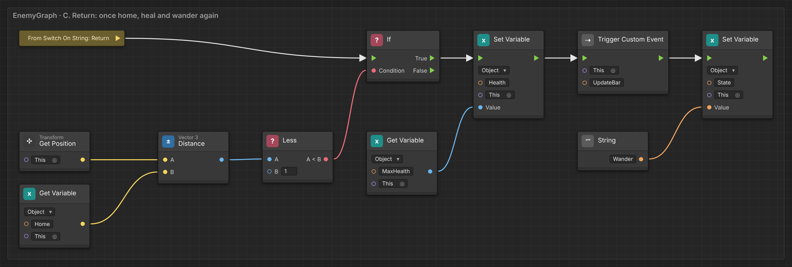

### 6.5 Part D: getting hit by the sword
A hit counts only if all four checks pass: it's the sword, it was swung hard
enough, the enemy is alive, and 2 s have passed since the last hit.

1. **On BS Trigger Enter** (Events → BS → Trigger). It fires when anything
   enters the Enemy's hitbox. Its **Collider** output is what touched it.
2. → **If**: **Collider: Compare Tag** (target: the Collider output) tag
   `UserTag1`. (Only the blade has this tag. Your body touching the enemy
   is ignored.)
3. True → **If**: swing speed **Greater Or Equal** `MinSwingSpeed`, where
   swing speed = Collider output → **Collider: Get Attached Rigidbody** →
   **Rigidbody: Get Linear Velocity** → **Vector 3: Get Magnitude**.

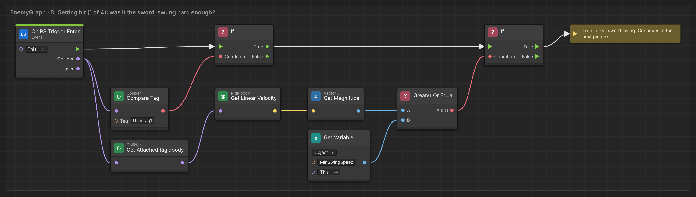

4. True → **If**: Get Variable `State` **Not Equal** `Dead`.
5. True → **If**: Get Time **Greater** `LastHitTime` + `SwingCooldown`.
   (Only one hit counts every 2 s.)

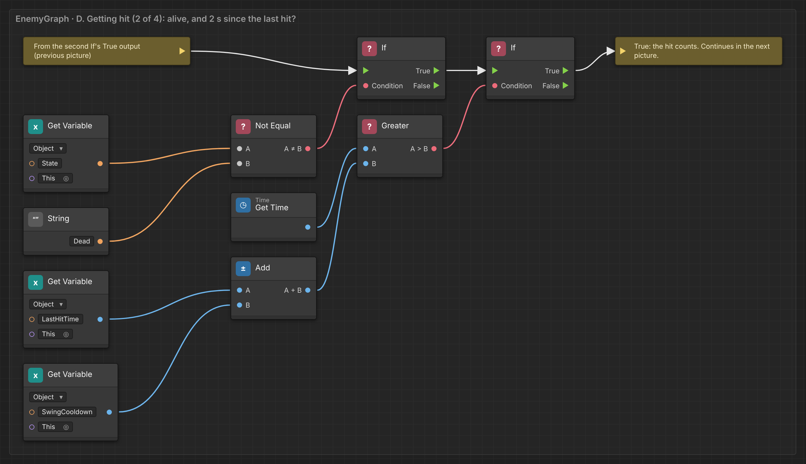

6. True →
   1. **Set Variable** `LastHitTime` = Get Time.
   2. **Set Variable** `Health` = `Health` − `SwordDamage`.
   3. **Trigger Custom Event** `UpdateBar`.
   4. **Animator: Set Trigger** (`Anim`) `Hit`.

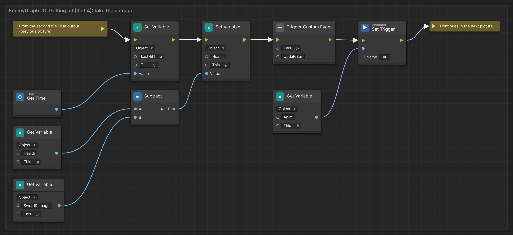

   5. → **If** `State` **Equal** `Wander` → True: **Set Variable** `State` =
      `Chase` (hitting it from behind makes it fight back).
   6. → **If** `Health` **Less Or Equal** `0` → True: **Trigger Custom
      Event** `Die`. (Wire **both** the Set Variable's output and the first
      If's **False** into this If.)

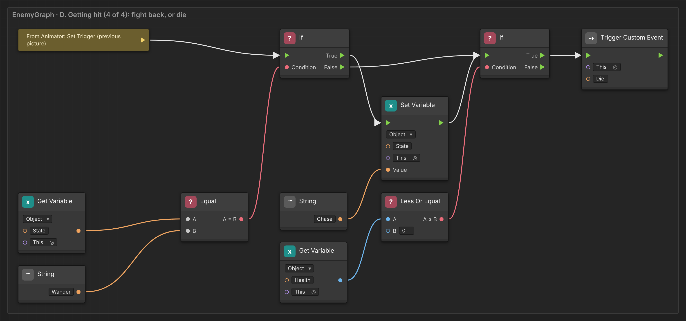

### 6.6 Part E: dying and coming back
1. **Custom Event** `Die`. Select it, and in the Graph Inspector tick
   **Coroutine** (this lets it wait).
2. → **Set Variable** `State` = `Dead`.
3. → **Nav Mesh Agent: Reset Path**.
4. → **Animator: Reset Trigger** (`Anim`) `Hit` → **Animator: Reset Trigger**
   (`Anim`) `Attack`. (The killing blow also asked for the Hit animation.
   Clearing it stops Hit from interrupting the death animation.)
5. → **Animator: Set Trigger** (`Anim`) `Die`.

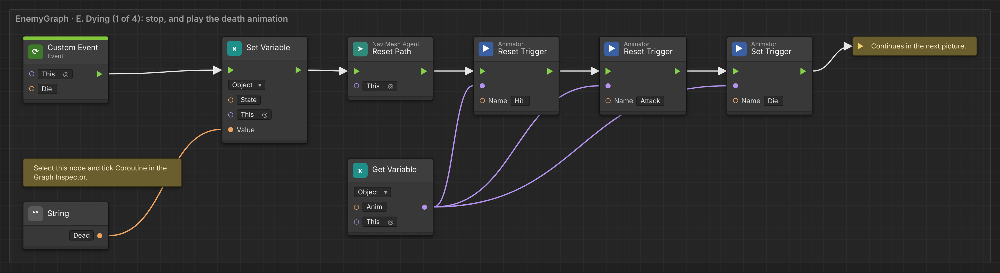

6. → **Capsule Collider: Set Enabled** (target **This**) = false (can't be hit
   while dead).
7. → **Game Object: Set Active** (target `HealthBar`) = false.
8. → **Wait For Seconds** `2` (let the death animation play) → **Game
   Object: Set Active** (`Model`) = false.

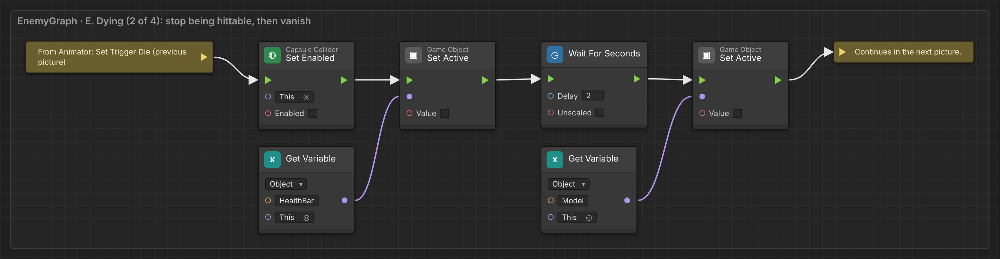

9. → **Wait For Seconds** ← `RespawnSeconds`.
10. → **Nav Mesh Agent: Warp** ← Get Variable `Home`.
11. → **Set Variable** `Health` ← `MaxHealth` → **Trigger Custom Event**
    `UpdateBar`.

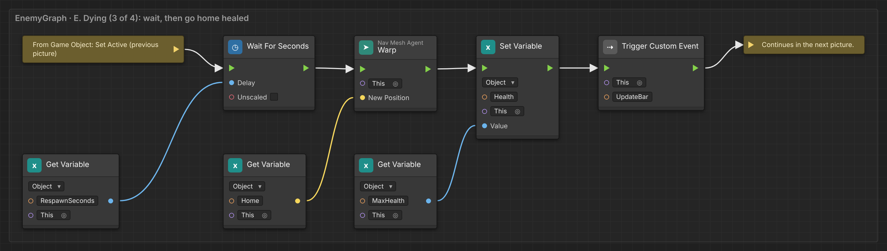

12. → **Game Object: Set Active** (`Model`) = true → (`HealthBar`) = true →
    **Capsule Collider: Set Enabled** = true.
13. → **Animator: Play** (target `Anim`), the version with **State Name** and
    **Layer**: State Name `Base Layer.Idle`, Layer `-1`. This jumps straight
    back to Idle, out of the death pose. (Use your state's exact name if it
    isn't `Idle`.)
14. → **Set Variable** `State` = `Wander`.

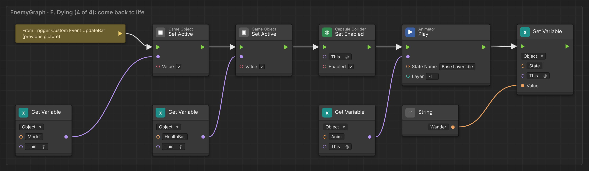

### 6.7 Part F: when you die, it goes home
1. **On Global Event**, name `PlayerDied`, Arguments `0`.
2. → **If**: `State` **Equal** `Chase` **Or** `State` **Equal** `Attack`
   (use **Equal** twice and an **Or**).
3. True → **Set Variable** `State` = `Return` → **Nav Mesh Agent: Set
   Destination** ← `Home`.

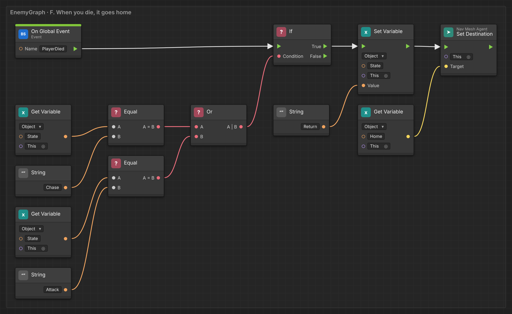

---

## Part 7: Test it

### 7.1 In Play mode (in the editor)
Press **Play**. The SDK gives you a desktop player (WASD to walk, mouse to
look, click to grab).

| Check | Expected |
|---|---|
| Enemy | Strolls around near its home, a new spot every 3–6 s, walk animation playing |
| Walk within 6 m | It turns and runs at you |
| Stand next to it | Attack animation every 1.6 s; your red HUD bar shrinks |
| Stand there ~30 s | You're teleported to the spawn point with full health; the enemy goes home |
| Run away 15 m from its home | It gives up and walks home, healing to full |
| Grab the sword and hit it | Works only with fast mouse moves. Real swings are a headset test |

**If nothing moves:** open **Window → Visual Scripting → Graph** while
playing and select `Enemy`. Active wires glow, so you can see which part runs.
Add **Debug: Log** nodes to print values to the Console.

### 7.2 Before publishing: the Builder check
1. **Creator SDK → Builder**. Sign in.
2. Look at the checklist. **Visual Scripting node support** must pass: it
   lists any node the app won't run. (Play mode doesn't check this, so a graph
   can work in the editor and not in the app.) Everything in this guide is on
   the allow list, but if you added something else, replace it.
3. Fix anything else the checklist flags (it has **Fix** buttons for most).
4. **Build & upload**.

### 7.3 In the headset
- [ ] Pick up the sword. Does it sit right in your hand? (If not, rotate the
      model under `Sword` in Unity.)
- [ ] Touch the enemy gently: no damage. Swing properly: health bar drops.
- [ ] Swing twice quickly: only the first counts (2 s).
- [ ] Does 1.5 m/s feel right as the minimum? (Change `MinSwingSpeed`.)
- [ ] Kill it: death animation, gone, back about 17 s later (2 s + 15 s).
- [ ] Let it beat you: back at the spawn point, full health.
- [ ] Is the HUD bar readable and not in the way? (Change the
      **Attachment Position** on `PlayerHUD`.)
- [ ] With a friend: each of you sees your own copy of the enemy (expected
      for now; see "Next steps").

---

## Part 8: Troubleshooting

| Problem | Try |
|---|---|
| Enemy doesn't move | NavMesh baked? (blue overlay on the ground.) Enemy placed on the blue area? Graph saved? A hole in the blue around the enemy: re-bake without **UserLayer9** (2.3) |
| Can't pick up the sword, or it won't move | `Sword`'s Rigidbody **Is Kinematic** must be off (3.1). The `Grip` must still have its collider and **BS Grab Handle** |
| Dead enemy jumps up again | Part E step 4: reset the `Hit` and `Attack` triggers before `Die`. In the Animator, the Death state must have no transitions out |
| Comes back to life still lying down | Part E step 13: **Animator: Play** needs the exact state name, with the layer in front: `Base Layer.Idle` |
| Enemy slides without animating | `Anim` variable points at the `Model`'s Animator? Parameter named exactly `Speed`? |
| Enemy floats or sinks | Change the NavMeshAgent's **Base Offset**, or the `Model` child's Y position |
| Sword hits never register | `Blade` has **Is Trigger** on, Tag **UserTag1**, and is a child of `Sword` (which has the Rigidbody)? Enemy's Capsule Collider **Is Trigger** on? Try moving `Blade` to the **Default** layer |
| Hits register even on gentle touches | Raise `MinSwingSpeed` |
| Health bar doesn't shrink | `BarPivot` variable points at `Bar Pivot` (not `Bar Fill`)? |
| Health bar is invisible in the headset | It's showing its back: rotate `Bar Background` and `Bar Pivot` 180° on Y |
| Works in Play mode, not in the app | The Builder's **Visual Scripting node support** check: a node isn't allowed. Also check the graph is saved and **Build & upload** ran |
| You don't respawn | `SpawnPoint` variable set on GameManager? On Global Event name is exactly `PlayerHit` / Arguments 1? |

---

## Next steps (after this works)

1. **Share the enemy between players** (design doc 6.3): make `Enemy` a **BS
   Synced Object** (with **Take Ownership On Collision** off), keep its health
   and state in **space state**, and only let the owner's copy run Parts B–C
   (check **Do I Own** first). The first player to land a hit calls **Take
   Ownership**.
2. **Connect to the backend** for XP, gold and quests: when the enemy dies,
   and when you die, tell the page (JavaScript) so it sends `kill` / `death`
   to the server. The test world's script already does this.
3. **PC press-to-attack (F)** stays: the page script already handles the F
   key; it will tell the enemy graph about a PC hit once step 2 connects them.
4. Swap the Slime numbers for each enemy type in `shared/rules.js` (Wolf,
   Goblin…), and turn the Enemy into a **prefab** so you can place many.

---

## Where this guide's facts come from

Checked against:
- **Altspace SDK documentation** (altvr.app/docs) and the **SDK's source code**
  (SideQuestVR/BanterSDK on GitHub): the BS nodes and components, and the
  Visual Scripting allow list (every Unity node used here is on it).
- **Unity Visual Scripting 1.9 manual** (the version the SDK uses): event,
  variable, custom event, switch, logic and wait nodes.
- **AI Navigation 2.0 manual**: NavMesh Surface and Nav Mesh Agent.
- **Unity 6000.3 manual and scripting reference**: Animator transitions and
  parameters, model import (Rig, Animation and Model tabs), Rigidbody
  (kinematic bodies, velocity), trigger messages, and the Render Pipeline
  Converter.

Not covered by those manuals, so worth a second look if Unity shows
something different: the exact fuzzy-finder wording for literal nodes, the
**Equal** node's Numeric option, and the **Expose** node (fallback above).

## About the graph pictures

They're drawn by `tools/graph-diagrams/` from a description of each graph in
`graphs.cjs`. If you change a graph in this guide, change it there too and
run `node tools/graph-diagrams/render.cjs` (needs Node.js and Playwright with
Chromium) to redraw the pictures in `docs/images/unity-graphs/`.
